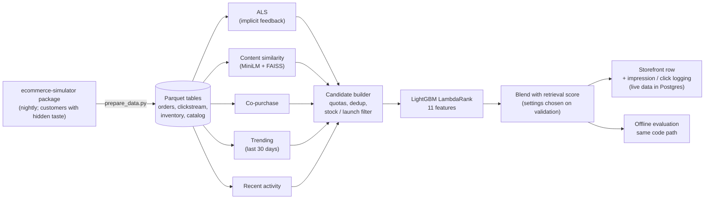

# Pantree — Hybrid Recommender on a Simulated Fashion Store

[](https://github.com/Meetpanchal58/pantree-commerce-platform/actions/workflows/ci.yml)
[](LICENSE)

<!-- TLDR:START -->
*Generated by `python -m recommendations.readme_summary`.*

- **What:** a fashion store (live storefront + 22 months of simulated history from the ecommerce-simulator package) with a hybrid recommender for the home-page "Recommended for you" row: five retrieval sources → LightGBM LambdaRank, evaluated on real held-out orders with only data known one hour before each order.
- **Result:** the served policy reaches NDCG@10 0.0763, +66% over retrieval order (95% CI +60% to +73%) and 2.5× random, level with an oracle that ranks by true taste alone (0.0743): shoppers here also follow popularity and page position.
- **Bottleneck:** only 34.2% of orders have a bought product anywhere in the 50-product candidate list, so retrieval caps the score (the ranker cannot recover a product that was never retrieved). Next step: better candidate generation, e.g. a two-tower retriever trained on views, impressions and orders.
<!-- TLDR:END -->

### [Live demo](https://pantree-storefront.onrender.com/login)

Hosted on Render's free tier; the first request after inactivity may take 30-60 seconds.

## The problem

An online fashion shop wants its home-page "Recommended for you" row to show products each
signed-in shopper will actually buy. The task here is the hard version: out of thousands of
products, put the exact products a customer bought near the top of the row, using only what was
known one hour before the order.

The shop's history (22 months: catalogue, customers, browsing, impressions, orders, stock, sale
events, marketing) comes from my [ecommerce-simulator](https://github.com/Meetpanchal58/ecommerce-simulator)
package, refreshed every night ([Hugging Face](https://huggingface.co/datasets/Meet58/ecommerce-simulator)).
Its customers have a hidden "true taste", so the evaluation can also say how close the system gets
to perfect knowledge.

<!-- RESULTS:START -->
## Results at a glance

*Generated from `recommendations/reports/evaluation_report.json` by `python -m recommendations.readme_summary`.*

- **Problem:** rank products for the home-page "Recommended for you" row, predicting the exact product bought among 8,727, using only data known one hour before the order.
- **Method:** 5 retrieval sources (implicit ALS, trending, recent activity, FAISS content similarity, co-purchase) → 11-feature LightGBM LambdaRank → 0.75 ranker + 0.25 retrieval-score blend for every customer (settings chosen on validation). The evaluated policy is the code the storefront serves (`recommendations/policy.py`).
- **Evaluation:** 3-period temporal split, 7-day embargo, 12,456 held-out orders (of 13,042; order counts in docs/recommender.md), paired-bootstrap 95% CIs.
- **Headline:** served policy NDCG@10 0.0763 vs 0.0459 for retrieval order: +0.0304 absolute (95% CI +0.0280 to +0.0328), +66% relative (95% CI +60% to +73%); 2.5× random. Within lists that contain a bought product (4,463 orders), NDCG@10 is 0.232.
- **Oracle:** the served policy matches an oracle that ranks by each customer's true taste alone (NDCG@10 0.0763 vs 0.0743): shoppers here also follow popularity, page position, stock and sales, so taste alone is not a ceiling. For first-time buyers, where the model knows little, the oracle is still ahead (0.056 vs 0.084).
- **Bottleneck:** only 34.2% of orders have a bought product anywhere in the 50-product candidate list, so retrieval caps the score (the ranker cannot recover a product that was never retrieved). Next step: better candidate generation, e.g. a two-tower retriever trained on views, impressions and orders.
- **Caveat:** synthetic data with known ground truth; online impression/click logging and an A/B split are built, but there is no real traffic yet.
<!-- RESULTS:END -->

Full tables by segment, significance tests, retrieval figures and the source ablation:
[docs/recommender.md](docs/recommender.md#evaluation).

## How it works



One module, `recommendations/policy.py`, builds and orders the candidate list for both the live
storefront and the offline evaluation, so the number reported is the system that is served. How each
storefront row works: [docs/recommender.md](docs/recommender.md).

## Why the numbers can be trusted

- **Real orders, no peeking.** Every held-out order is a query made one hour before it was placed.
  Three time periods (retrieval models, ranker training, test) with a 7-day embargo; settings are
  chosen on a validation slice and the test period is scored once.
- **What is evaluated is what is served.** Serving and evaluation call the same policy code, and
  `tests/test_policy_parity.py` checks they return identical lists and scores.
- **Point-in-time inputs.** Popularity, trending, customer history and stock are taken as of the
  query; `tests/test_leakage.py` adds events from the query hour (and the order itself) and checks
  that nothing changes.
- **No ground truth in the model.** Only the evaluation-only oracle may read the simulator's hidden
  taste; `tests/test_ground_truth_guard.py` blocks it everywhere else.
- **Baselines and an oracle.** Random, popularity and retrieval order are scored on the same lists,
  plus an oracle that knows each customer's true taste. Differences come with paired-bootstrap 95%
  confidence intervals.
- **Validated data.** The package checks every published day (16 consistency checks: keys,
  lifecycle order, money, prices, stock flows); CI downloads the small shop and runs the test
  suite, including the storefront journey on a real Postgres, on every push.

Details: [docs/recommender.md](docs/recommender.md#evaluation).

## Analytics and churn

`analysis/insights.ipynb` explores the shop's data (re-run it with
`jupyter execute --inplace analysis/insights.ipynb` after `pip install -r requirements-analysis.txt`). Findings on the full shop:

<!-- INSIGHTS:START -->
*Generated from `recommendations/reports/insights_summary.json`, written when `analysis/insights.ipynb` runs.*

- **Conversion:** 4.4% of 1,576,301 sessions end in a purchase; 45% of cart adds are bought.
- **Cash on delivery:** 7.9% of COD parcels come back undelivered (RTO) vs 0.0% for prepaid (2349.8×).
- **Returns:** 20.2% of delivered items are returned (footwear 25.3%, accessories 7.6%); size and fit problems explain 36% of returns.
- **Channels:** a referral customer is worth ₹3,478 on average vs ₹680 for paid_social (5.1×).
- **Repeat buyers:** 48% of buyers order again and bring 81% of revenue.
- **Discounts:** shoppers pay 72% of MRP on sale-event days vs 86% on normal days.
- **Sale events:** daily revenue during Diwali 2025 +124%, Diwali 2026 +124% vs the two weeks before (big events overall +115%); a local baseline controls for the shop's growth.
- **Churn model:** on the latest held-out snapshots (temporal split, 90-day embargo), logistic regression (chosen on validation) reaches ROC-AUC 0.723 (95% CI 0.711–0.734) vs 0.609 for a days-since-last-order rule; targeting the top 10% catches 14% of churners at 1.4× the base rate (55%). Weak, but leakage-free.
<!-- INSIGHTS:END -->

<!-- LEAK:START -->
*Generated from `recommendations/reports/churn_leak_before_fix.json`.*

**A leak I found in my own data.** In an earlier version of this project, the first churn model looked good: gradient boosting reached test ROC-AUC **0.751**. The old generator's monthly churn features counted the whole snapshot month, so 26,729 of 567,540 feature rows included orders placed after `snapshot_date`, overlapping the label window. Rebuilt strictly before the snapshot, the same model scores **0.580**. The data now comes from the ecommerce-simulator package, whose features are built point-in-time, and the notebook checks that before using them (0 leaky rows).
<!-- LEAK:END -->

## Limitations

- This is **realistic synthetic data** with deliberately engineered, documented signal — it is
  validated and leakage-checked, but it is simulated, not production data.
- Browsing in the simulator follows each customer's hidden taste (with position bias and
  exploration), so views and cart adds carry preference signal; the strength of that signal is a
  modelling choice.
- The headline evaluation is an offline replay on historical orders. The site now logs
  recommendation impressions and clicks and supports an A/B split, but those numbers need real
  traffic, which the demo does not have yet.
- Products come from a real public fashion catalogue (Kaggle *Fashion Product Images*), so names
  and images are real; prices, customers and behaviour are simulated.
- The served settings were chosen on a single validation period; the margins between the best few
  settings are small, so a different period could pick differently.

## What I'd do next

<!-- NEXT:START -->
*Generated from the evaluation and tuning reports by `python -m recommendations.readme_summary`.*

- **Improve candidate coverage.** The candidate list holds a bought product for 34.2% of test orders (recall 0.316); every order without one is a guaranteed miss. A stronger retriever (e.g. a two-tower model trained on views, impressions and orders) is worth more than further ranking work.
- **Settle ranker alone vs blend.** Validation preferred a 0.75 ranker weight over the ranker alone by +0.0002 NDCG@10 (0.0778 vs 0.0777); on test the gap is -0.0019 (0.0763 vs 0.0782). Both margins are small, so the A2 search did not really settle it; repeated validation splits (or a longer validation period) would.
<!-- NEXT:END -->

## Quickstart

Python 3.11+ (CI uses 3.13). From the project folder:

```bash
python -m venv .venv && source .venv/bin/activate
pip install -r requirements.txt
python prepare_data.py                         # download the shop's data (about a minute; --size small for laptops)
python -m recommendations.tune_als             # ALS settings (validation period)
python -m recommendations.tune_policy          # quotas, pool size, blend, first-timer rule, trending window
python -m recommendations.evaluate             # test-period evaluation + ablation
python -m recommendations.readme_summary       # regenerate the numbers in this README and docs/recommender.md
python webapp/seed_db.py                       # storefront database (SQLite, or Postgres if DATABASE_URL is set)
python -m uvicorn webapp.app:app --host 127.0.0.1 --port 8000
```

Sign-in setup (SuperTokens, email or phone codes), Windows commands, hosting on Render with the Neon
Postgres live database, and "Reset my recommendations": [docs/setup.md](docs/setup.md).

## Repository map

| Path | What it holds |
|---|---|
| `prepare_data.py` | Downloads the shop's data from the ecommerce-simulator package and converts it |
| `recommendations/candidates/` | Retrieval sources: ALS, content (FAISS), co-purchase / FBT, popularity |
| `recommendations/policy.py` | The personalised policy shared by serving and evaluation |
| `recommendations/ranker.py` | Point-in-time features and the LightGBM ranker |
| `recommendations/evaluate.py`, `tune_als.py`, `tune_policy.py` | Offline evaluation and tuning |
| `recommendations/oracle.py` | Evaluation-only oracle and retrieval ceiling |
| `recommendations/reports/` | Generated reports and the chosen settings |
| `webapp/` | FastAPI storefront, sign-in, live database (Postgres / SQLite), recommendation logging, account reset |
| `analysis/` | Insights notebook and churn analysis |
| `docs/` | [Setup](docs/setup.md) (run, sign-in, hosting), [recommender](docs/recommender.md) (method + evaluation), [data](docs/data.md) |
| `tests/` | Unit, parity, leakage and guard tests |

## License

[MIT](LICENSE) © Meet Panchal
