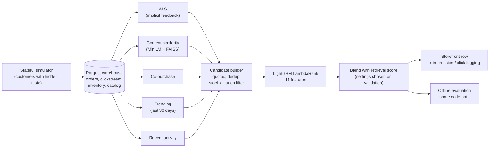

# Pantree — Hybrid Recommender on a Simulated Fashion Store

[](https://github.com/Meetpanchal58/pantree-commerce-platform/actions/workflows/ci.yml)
[](LICENSE)

<!-- TLDR:START -->
*Generated by `python -m recommendations.readme_summary`.*

- **What:** a simulated fashion store (stateful data generator + live storefront) with a hybrid recommender for the home-page "Recommended for you" row: five retrieval sources → LightGBM LambdaRank, evaluated on real held-out orders with only data known one hour before each order.
- **Result:** the served policy reaches NDCG@10 0.0386, +61% over retrieval order (95% CI +49% to +76%) and 6.2× random, capturing 83% of the gap between random and an oracle that knows each customer's true taste.
- **Bottleneck:** candidate lists contain a bought product for 20.4% of orders vs 46.2% for the top 150 by true taste — retrieval, not ranking, limits the score.
<!-- TLDR:END -->

### [Live demo](https://pantree-storefront.onrender.com/login)

Hosted on Render's free tier; the first request after inactivity may take 30-60 seconds.

## The problem

An online fashion shop wants its home-page "Recommended for you" row to show products each
signed-in shopper will actually buy. The task here is the hard version: out of 10,000 products,
put the exact products a customer bought near the top of the row, using only what was known one
hour before the order. Everything runs on a simulated store whose customers have a hidden "true
taste", so the evaluation can also say how close the system gets to perfect knowledge.

<!-- RESULTS:START -->
## Results at a glance

*Generated from `recommendations/reports/evaluation_report.json` by `python -m recommendations.readme_summary`.*

- **Problem:** rank products for the home-page "Recommended for you" row, predicting the exact product bought among 10,000, using only data known one hour before the order.
- **Method:** 5 retrieval sources (implicit ALS, trending, recent activity, FAISS content similarity, co-purchase) → 11-feature LightGBM LambdaRank → 0.75 ranker + 0.25 retrieval-score blend for every customer (settings chosen on validation). The evaluated policy is the code the storefront serves (`recommendations/policy.py`).
- **Evaluation:** 3-period temporal split, 7-day embargo, 5,647 held-out orders (of 5,831; order counts in docs/evaluation.md), paired-bootstrap 95% CIs.
- **Headline:** served policy NDCG@10 0.0386 vs 0.0239 for retrieval order: +0.0147 absolute (95% CI +0.0122 to +0.0172), +61% relative (95% CI +49% to +76%); 6.2× random. Within lists that contain a bought product (1,191 orders), NDCG@10 is 0.205.
- **Ceiling:** the served policy captures 83% of the achievable gain from random to an oracle that knows each customer's true taste (95% CI 73% to 94%).
- **Bottleneck:** candidate lists contain a bought product for 20.4% of orders; the top 150 by true taste would contain one for 46.2%. Next step: better retrieval (taste-aware candidate generation, e.g. a two-tower model), not more ranking features.
- **Caveat:** synthetic data with known ground truth; online impression/click logging and an A/B split are built, but there is no real traffic yet.
<!-- RESULTS:END -->

Full tables by segment, significance tests, retrieval figures and the source ablation:
[docs/evaluation.md](docs/evaluation.md).

## How it works



One module, `recommendations/policy.py`, builds and orders the candidate list for both the live
storefront and the offline evaluation, so the number reported is the system that is served. How each
storefront row works: [docs/recommender.md](docs/recommender.md).

## Why the numbers can be trusted

- **Real orders, no peeking.** Every held-out order is a query made one hour before it was placed.
  Three time periods (retrieval models, ranker training, test) with a 7-day embargo; settings are
  chosen on a validation slice and the test period is scored once.
- **What is evaluated is what is served.** Serving and evaluation call the same policy code, and
  `tests/test_policy_parity.py` checks they return identical lists and scores.
- **Point-in-time inputs.** Popularity, trending, customer history and stock are taken as of the
  query; `tests/test_leakage.py` adds events from the query hour (and the order itself) and checks
  that nothing changes.
- **No ground truth in the model.** Only the evaluation-only oracle may read the simulator's hidden
  taste; `tests/test_ground_truth_guard.py` blocks it everywhere else.
- **Baselines and a ceiling.** Random, popularity and retrieval order are scored on the same lists,
  plus an oracle that knows each customer's true taste. Differences come with paired-bootstrap 95%
  confidence intervals.
- **Validated data.** `validators/preflight_checks.py` runs the dataset consistency checks on the
  generated warehouse; CI runs it and the test suite on every push.

Details: [docs/evaluation.md](docs/evaluation.md).

## Analytics and churn

`analysis/pantree_insights.ipynb` explores the generated warehouse (rebuild it with
`python analysis/build_notebook.py`). Findings on the default dataset:

<!-- INSIGHTS:START -->
*Generated from `analysis/insights_summary.json`, written when the notebook runs.*

- **Conversion:** 3.2% of 821,728 sessions end in a purchase; 10% of cart adds are bought.
- **Cash on delivery:** 6.4% of COD parcels come back undelivered (RTO) vs 2.6% for prepaid (2.5×).
- **Returns:** 17.0% of delivered items are returned (footwear 19.7%, accessories 12.5%); size and fit problems explain 40% of returns.
- **Channels:** a Referral customer is worth ₹4,425 on average vs ₹1,534 for Social Ads (2.9×).
- **Repeat buyers:** 56% of buyers order again and bring 83% of revenue.
- **Price change:** after 1 Feb 2025 customers paid +8.6% relative to list price.
- **Festivals:** Diwali months show Oct 2025 +83%, Nov 2025 +75% revenue vs the neighbouring normal months (festival months overall +39%); comparing with neighbours controls for the shop's growth.
- **Churn model:** on the latest held-out snapshots (temporal split, 90-day embargo), logistic regression (chosen on validation) reaches ROC-AUC 0.605 (95% CI 0.590–0.620) vs 0.545 for a days-since-last-order rule; targeting the top 10% catches 12% of churners at 1.2× the base rate (56%). Weak, but leakage-free.
<!-- INSIGHTS:END -->

<!-- LEAK:START -->
*Generated from `analysis/reports/churn_leak_before_fix.json`.*

**A leak I found in my own data.** The first churn model looked good: gradient boosting reached test ROC-AUC **0.751**. The generator's monthly churn features counted the whole snapshot month, so 26,729 of 567,540 feature rows included orders placed after `snapshot_date`, overlapping the label window. Rebuilt strictly before the snapshot, the same model scores **0.580**. The generator now builds features point-in-time (0 leaky rows), and `validators/validate_dataset.py` fails if that ever regresses.
<!-- LEAK:END -->

## Limitations

- This is **realistic synthetic data** with deliberately engineered, documented signal — it is
  validated and leakage-checked, but it is simulated, not production data.
- Browsing in the simulator follows each customer's hidden taste with 20% exploration, so views
  and cart adds carry preference signal; the strength of that signal is a modelling choice.
- The headline evaluation is an offline replay on historical orders. The site now logs
  recommendation impressions and clicks and supports an A/B split, but those numbers need real
  traffic, which the demo does not have yet.
- Product images source from a real fashion catalogue (`generators/product_details.csv`);
  for the live site, images are served locally so they always load.
- The served settings were chosen on a single validation period; the margins between the best few
  settings are small, so a different period could pick differently.

## What I'd do next

<!-- NEXT:START -->
*Generated from the evaluation and tuning reports by `python -m recommendations.readme_summary`.*

- **Improve candidate coverage.** The candidate list holds a bought product for 20.4% of test orders (recall 0.167); the top 150 products by true taste would hold one for 46.2% (recall 0.398). Closing that gap (e.g. a two-tower retriever trained on views and orders) is worth more than further ranking work.
- **Re-check the recent-activity source on validation.** In the test-period ablation, removing it moved served NDCG@10 by +0.0014 (95% CI +0.0002 to +0.0026) while candidate recall fell from 0.1667 to 0.1596. A decision made on test would be biased, so the source stays until a validation run says otherwise.
- **Settle ranker alone vs blend.** Validation preferred a 0.75 ranker weight over the ranker alone by +0.0013 NDCG@10 (0.0386 vs 0.0373); on test the gap is +0.0002 (0.0386 vs 0.0384). Both margins are small, so the A2 search did not really settle it; repeated validation splits (or a longer validation period) would.
<!-- NEXT:END -->

## Quickstart

Python 3.11+ (CI uses 3.13). From the project folder:

```bash
python -m venv .venv && source .venv/bin/activate
pip install -r requirements.txt
python generate_data.py --mode initialize      # simulated warehouse in data/ (replaces existing files)
python validators/preflight_checks.py          # consistency checks
python -m recommendations.tune_als             # ALS settings (validation period)
python -m recommendations.tune_policy          # quotas, pool size, blend, first-timer rule, trending window
python -m recommendations.evaluate             # test-period evaluation + ablation
python -m recommendations.readme_summary       # regenerate the numbers in this README and docs/evaluation.md
python webapp/seed_db.py                       # storefront database
python -m uvicorn webapp.app:app --host 127.0.0.1 --port 8000
```

Sign-in setup (SuperTokens, email or phone codes), Windows commands and dataset sizing:
[docs/running.md](docs/running.md). Hosting: [docs/deployment.md](docs/deployment.md).

## Repository map

| Path | What it holds |
|---|---|
| `generators/` | Stateful simulator: customers, catalog, browsing, orders, inventory, marketing, support |
| `validators/` | Dataset checks (`preflight_checks.py` runs them all) |
| `recommendations/candidates/` | Retrieval sources: ALS, content (FAISS), co-purchase / FBT, popularity |
| `recommendations/policy.py` | The personalised policy shared by serving and evaluation |
| `recommendations/ranker.py` | Point-in-time features and the LightGBM ranker |
| `recommendations/evaluate.py`, `tune_als.py`, `tune_policy.py` | Offline evaluation and tuning |
| `recommendations/oracle.py` | Evaluation-only oracle and retrieval ceiling |
| `recommendations/reports/` | Generated reports and the chosen settings |
| `webapp/` | FastAPI storefront, sign-in, recommendation logging |
| `analysis/` | Insights notebook and churn analysis |
| `docs/` | [Recommender](docs/recommender.md), [evaluation](docs/evaluation.md), [data](docs/data.md), [running](docs/running.md), [deployment](docs/deployment.md), [glossary](docs/glossary.md) |
| `tests/` | Unit, parity, leakage and guard tests |

## License

[MIT](LICENSE) © Meet Panchal
